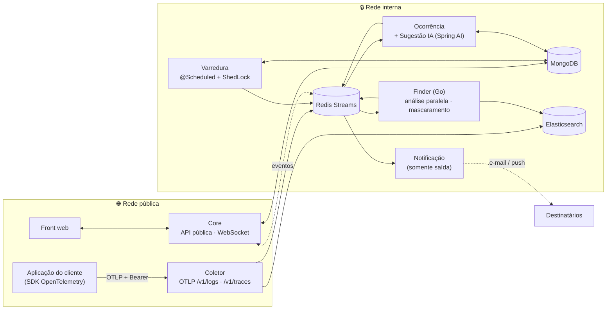

<div align="center">

# 🦙 LhamaLog

**Seus logs analisados por IA: problemas encontrados, dados sensíveis mascarados e alertas para quem precisa saber.**

Plataforma SaaS multi-tenant de análise de logs com inteligência artificial, baseada em OpenTelemetry.


</div>

---

## 📌 Sobre o projeto

O **LhamaLog** recebe logs e traces das aplicações dos clientes pelo protocolo aberto **OpenTelemetry (OTLP)**, varre esses dados em busca de erros e comportamentos anômalos, **mascara informações sensíveis**, abre **ocorrências** e usa **IA generativa** para sugerir causas e correções. Cada cliente (tenant) tem seus produtos, papéis e regras de alerta isolados.

É um projeto acadêmico da **Escola de TI da UniCesumar**, curso de **Engenharia de Software**.

## ⚙️ Como funciona

1. A aplicação do cliente envia logs/traces via OTLP (`/v1/logs` e `/v1/traces`) com um **token Bearer por produto**.
2. O **Coletor** valida, armazena e publica os eventos no **Redis Streams**.
3. A **Varredura** dispara execuções de análise de forma agendada (`@Scheduled` + ShedLock em MongoDB) ou por gatilho de volume na fila.
4. O **Finder** (em Go, com processamento paralelo) encontra problemas e mascara dados sensíveis.
5. A **Ocorrência** abre e fecha ocorrências e pede sugestões de IA (Spring AI).
6. A **Notificação** avisa as pessoas certas conforme a matriz de alertas.
7. O **Core** é a API pública do front: assinatura, tenants, papéis, alertas e WebSocket.



> Somente **Core** e **Coletor** são expostos publicamente; os demais serviços ficam na rede interna.

## 📦 Repositórios

| Repositório | Papel | Tecnologia |
|---|---|---|
| `lhamalog-core` | API pública do front: assinatura, multi-tenant (Clerk Organizations), papéis e matriz de alertas, WebSocket | Java 25 · Spring Boot 4.1.1 |
| `lhamalog-coletor` | Ingestão OTLP (`/v1/logs`, `/v1/traces`), autenticação por token de produto, gravação de logs | Java 25 · Spring Boot · Elasticsearch |
| `lhamalog-varredura` | Agenda e dispara execuções de análise | Java 25 · Spring Boot · ShedLock (MongoDB) |
| `lhamalog-finder` | Encontra problemas nos logs, em paralelo, e mascara dados sensíveis | Go 1.27.2 |
| `lhamalog-ocorrencia` | Ciclo de vida das ocorrências e sugestões de IA | Java 25 · Spring Boot · Spring AI 2.0.0 |
| `lhamalog-notificacao` | Envio de notificações (somente saída) | Java 25 · Spring Boot |
| front web | Interface do usuário | [PENDENTE] nome do repositório |

## 🧰 Stack

- **Linguagens e frameworks:** Java 25 (LTS), Spring Boot 4.1.1, Spring AI 2.0.0, Go 1.27.2
- **Build:** Maven (groupId `br.com.lhamalog`), Go modules, Makefile por repositório
- **Dados e mensageria:** MongoDB, Elasticsearch, Redis Streams
- **Observabilidade:** OpenTelemetry (OTLP)
- **Infra local:** Docker e docker-compose
- **Identidade:** Clerk (em análise)
- **Gestão:** Jira e Google Drive
- **CI:** sem GitHub Actions por enquanto; builds e testes rodam localmente

## 🏛️ Princípios de arquitetura

- **Hexagonal leve (ports and adapters):** o domínio não conhece banco, fila nem HTTP.
- **Sem biblioteca comum:** não existe `lhamalog-commons`; cada repositório mantém suas classes-padrão a partir dos guias da equipe.
- **Decisões registradas em ADRs:** já são mais de 140 Architecture Decision Records.
- **Dependências controladas:** consulte o documento *Dependências específicas dos módulos* antes de adicionar qualquer biblioteca, para evitar duas libs com a mesma função.
- **Multi-tenant por padrão:** isolamento por tenant em todas as camadas.

> A documentação interna (ADRs, diagramas, guias e planos) fica no Google Drive da equipe.

## 🚀 Como começar

Pré-requisitos: **JDK 25**, **Go 1.27.x**, **Docker** e **make**.

```bash
# Infra local (MongoDB, Redis, Elasticsearch)
make infra-up

# Rodar e testar o serviço
make run
make test
```

Equivalentes diretos:

```bash
# Serviços Java
./mvnw spring-boot:run
./mvnw clean verify
./mvnw package && java -jar target/lhamalog-<modulo>-0.0.1-SNAPSHOT.jar

# Finder (Go)
go run ./cmd/finder
go test ./...
```

## 📚 Referências

- [Especificação OTLP — OpenTelemetry](https://opentelemetry.io/docs/specs/otlp/)
- [Documentação do Spring Boot](https://docs.spring.io/spring-boot/)
- [Documentação do Spring AI](https://docs.spring.io/spring-ai/reference/)
- [Redis Streams](https://redis.io/docs/latest/develop/data-types/streams/)
- [ShedLock](https://github.com/lukas-krecan/ShedLock)
- [Documentação do MongoDB](https://www.mongodb.com/docs/)
- [Documentação do Elasticsearch](https://www.elastic.co/docs)
- [Documentação do Go](https://go.dev/doc/)
- [OpenJDK 25](https://openjdk.org/projects/jdk/25/)
- [Apache Maven](https://maven.apache.org/)
- [Clerk](https://clerk.com/docs)
- [Documenting Architecture Decisions — Michael Nygard](https://cognitect.com/blog/2011/11/15/documenting-architecture-decisions)
- [Hexagonal Architecture — Alistair Cockburn](https://alistair.cockburn.us/hexagonal-architecture/)

## 🔭 Em definição

- [PENDENTE] Provedor de LLM
- [PENDENTE] Banco vetorial
- [PENDENTE] Gateway de pagamento
- [PENDENTE] Nome da organização no GitHub

## 👥 Equipe

- Michel Colognese Bocchi Junior
- João Pedro Souza Peixoto Saraiva
- Pedro Alvaro
- Andre Felipe
- Vinicius Ferrarini
- Fellipe Barreto

## 🎓 Instituição

Projeto da **Escola de TI** da [UniCesumar](https://www.unicesumar.edu.br/), curso de **Engenharia de Software**.
